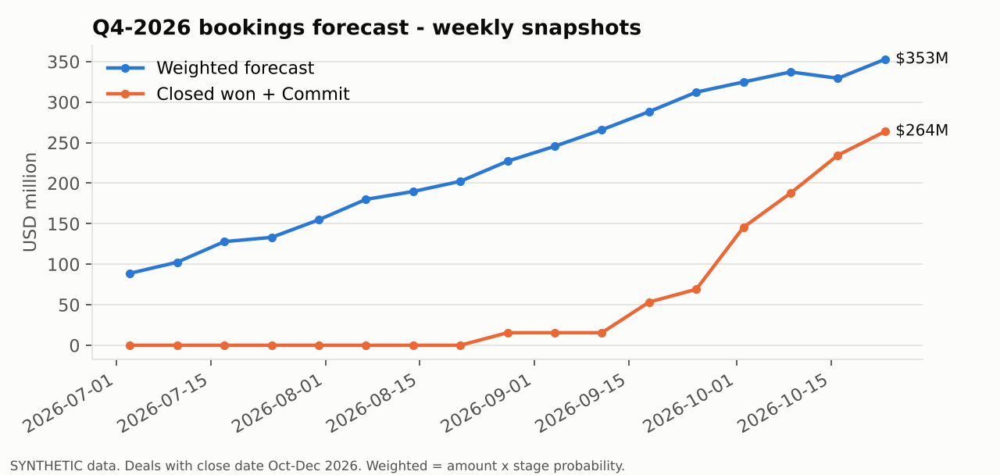

# Solar Deal Desk: financial modelling and business analytics

*A 4-week portfolio project | Excel · SQL/Python · PowerPoint · Salesforce-ready CRM data*

*Built by Manjit Mandal. All companies, people and data are fictional or synthetic.*



**The business problem.** A utility-scale solar tracker supplier needs an analyst who can turn a customer request into a priced, margin-checked quote, back it with a customer value case, track it in the CRM, and roll it into a weekly revenue forecast and win/loss insight. This project builds that workflow for **one connected deal** and a **separate synthetic pipeline**.

```
Customer requirements → Energy assumptions → Quote → Margin validation → Proposal → CRM pipeline → Revenue forecast → Win/loss insights
```

> **Data labels used throughout.** **PVGIS simulated** = output of the EU JRC PVGIS model for a fictional site; this is a simulated scenario and does not prove any manufacturer's real-world tracker performance. **Market benchmark** = public data point with a cited source. **SYNTHETIC** = made-up but realistic values chosen for this exercise. All companies (SunAxis Trackers, Thar Sun Energy, Competitors A–C) and people are fictional.

---

## 1. Files

| Folder | File | What it is |
|---|---|---|
| `01-02_Quote_and_Energy_Model/` | `Solar_Deal_Desk_Model.xlsx` | Main model. Sheets: Cover, Deal_Summary, **Assumptions** (single source of truth), Energy, Quote_Calculator, Sensitivity, Tracker_Value, Project_Finance (stretch) |
| `03_CRM_Pipeline/` | `synthetic_opportunities.csv` | 150 synthetic opportunities + the primary Thar Sun deal |
| | `weekly_pipeline_snapshots.csv` | Stage of every deal each Friday, 03-Jul → 23-Oct-2026 |
| | `salesforce_import_*.csv` | Import-ready files for Salesforce |
| | `Salesforce_Setup_Guide.md` | Stages, custom fields, validation rule, import and dashboard steps |
| | `generate_synthetic_pipeline.py` | Reproducible generator (seed 42) documenting every data assumption |
| `04_Analytics/` | `queries.sql`, `analysis.py` | SQL win/loss and forecast queries run via Python + SQLite; charts |
| | `Pipeline_Analytics.xlsx` | The same analysis with live COUNTIFS/SUMIFS formulas |
| | `outputs/` | Query result CSVs and charts (PNG) |
| `05_Proposal_Pack/` | `01_Customer_Requirements_Brief.docx` | Half-page brief written **before** modelling; assumptions marked [A] |
| | `02_Customer_Quotation.docx` | Customer-facing quotation with the value case |
| | `03_Bankability_Checklist.docx` | 14 documents lenders / IEs expect from a tracker supplier, with status |
| | `04_Deal_Desk_Approval_Note_INTERNAL.docx` | Internal margin, risk and approval recommendation |
| | `05_Management_Presentation.pptx` | 6-slide management deck |

**Run the analytics:** `cd 04_Analytics && python analysis.py` (needs pandas and matplotlib). To regenerate the data: `cd 03_CRM_Pipeline && python generate_synthetic_pipeline.py`.

---

## 2. One connected deal: key assumptions

Every number below lives once, on the **Assumptions** sheet. The quotation, approval note, deck and Salesforce import file all use the same values.

| Parameter | Value | Type |
|---|---|---|
| Plant size | 100 MWp (DC), Jodhpur district, Rajasthan (27.30°N, 72.40°E) | Customer brief |
| Fixed-tilt yield (30°, optimal) | 1,747.1 kWh/kWp/yr | PVGIS simulated |
| Single-axis tracker yield (ideal) | 2,171.4 kWh/kWp/yr (+24.3%) | PVGIS simulated |
| Share of simulated gain realised | 70% → planning gain +17.0% | Synthetic assumption |
| PPA tariff | INR 2.60/kWh | Market benchmark (Indian ISTS auctions INR 2.55–2.68) |
| FX | 94.95 INR/USD | Market benchmark (23-Oct-2026 close) |
| Tracker direct cost | INR 6.43/Wp (70% steel-linked, 19% USD-linked) | Synthetic |
| List price / discount | INR 8.10/Wp / 3% | Synthetic |
| CM floor / target | 12% / 18% | Synthetic |
| Competitor offer | INR 7.60/Wp | Customer brief (fictional) |
| Customer WACC | 9% | Synthetic |

## 3. Key formulas

| Measure | Formula |
|---|---|
| Net price | List × (1 − discount) |
| Contribution margin | Net price − direct cost − warranty reserve − commission |
| **Minimum acceptable price** | Direct cost ÷ (1 − CM floor − warranty % − commission %) |
| Max discount | 1 − Minimum acceptable price ÷ List |
| Planning tracker yield | Fixed + (Tracker ideal − Fixed) × realisation factor |
| NPV of tracker upgrade | −(Tracker price − Fixed structure price) × MWp/10 + NPV(WACC, extra revenue − extra O&M) |
| **Break-even tracker price** | Fixed structure price + PV of incremental benefits ÷ (MWp/10) |
| Weighted forecast | Σ Amount × stage probability |
| Win rate | Won ÷ (Won + Lost) |
| LCOE (stretch) | (Capex + PV of O&M) ÷ PV of energy |

*Unit note:* INR crore = INR/Wp × MWp ÷ 10.

## 4. Key findings

**Quote and margin**

- Net price **INR 7.86/Wp**, contract **INR 78.57 crore (≈ USD 8.27M)**, contribution margin **15.6%**. Status: OK, below target. Needs **Sales Manager** approval only.
- Minimum acceptable price is **INR 7.53/Wp**, so the maximum discount is **7.1%**. Matching the competitor's INR 7.60 leaves CM at **12.8%**, which is no buffer.
- **Steel is the main risk**: a +10% steel move takes CM to 9.9%, below the floor. FX is secondary: +2.5 INR/USD costs about 0.4 pts.

**Customer value (simulated)**

- The tracker adds **+29.7 GWh in year 1**. The upgrade costs INR 38.6 crore more than fixed-tilt, has an **NPV of INR 26.8 crore**, an **IRR of 17.3%**, and pays back in **5.5 years**.
- The **break-even tracker price is INR 10.54/Wp**, against our INR 7.86. Our INR 2.57 crore premium over the competitor is recovered with **0.6% extra yield**.
- Stretch view: LCOE falls from INR 2.43 to 2.31/kWh, and project IRR rises from 10.1% to 10.8% (pre-tax).

**Pipeline (synthetic)**

- Q4-2026 forecast: floor **$264M**, weighted **$353M** (+$23.4M week on week), stretch **$457M**.
- Overall win rate is **38%** (33 of 86 closed). By value proposition: bankability 59%, energy yield 47%, lowest capex 24%.
- Price causes **32%** of losses and fixed-tilt **23%**.
- Existing customers convert at **64%**. Discounts above 6% buy a higher win rate (48%) at an average CM of only 10.9%.

## 5. Synthetic data: how it was generated

`generate_synthetic_pipeline.py` with random seed 42:

- **Regions and deal sizes:** India 40% (50–300 MWp), Middle East 18% (100–500), Latin America 16%, Australia 14%, Europe 12%.
- **Price:** a regional base USD/Wp ±6%, minus the discount (0–10%).
- **Created dates:** 01-Jul-2025 to 14-Oct-2026. Sales cycle is lognormal with a median of about 170 days (60–420). A deal is closed if its close date is on or before 23-Oct-2026.
- **Win probability:** 33% base, adjusted by lead source (existing customer +20 pts … inbound web −12), value proposition (bankability +10 … lowest capex −10), segment and region. These patterns are **built in on purpose**, so the analysis shows that the method finds them. They are not real market facts.
- **Loss reasons:** weighted by context (e.g. "Lowest capex" pitches lose more on price).
- **Open-deal stage:** set by elapsed share of the sales cycle. Stage probabilities are 10/20/40/60/80%.
- **Weekly snapshots:** each deal's stage recomputed every Friday. Close dates are held at their final value (no slippage modelled).

## 6. Limitations

- **Energy:** PVGIS is a general-purpose model. Its single-axis option assumes ideal rotation with no backtracking, row-to-row shading, stow or availability losses, hence the 70% realisation haircut. A bankable study would use PVsyst or SAM with the real layout, GCR, bifacial modules and P50/P90.
- **Costs:** costs, prices and O&M are synthetic and have not been checked against any real supplier.
- **Finance:** the project finance sheet is pre-tax and simplified (no depreciation, tax, DSRA or working capital).
- **Sample size:** 9–35 closed deals per group, so the results are directional only.
- **Forecast:** close dates never slip in the snapshots, unlike real pipelines.
